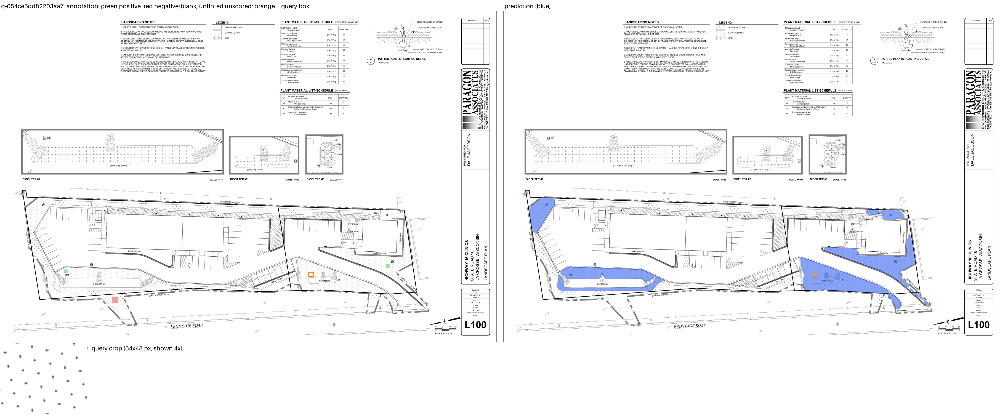
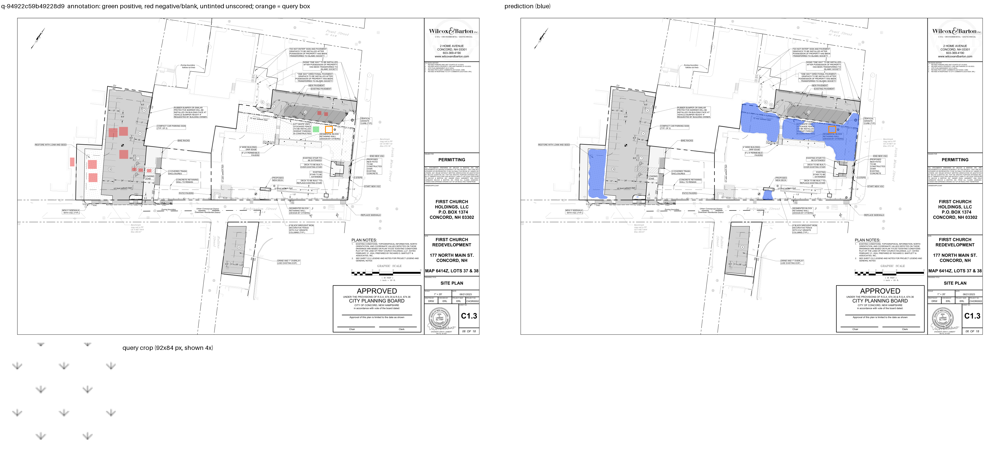
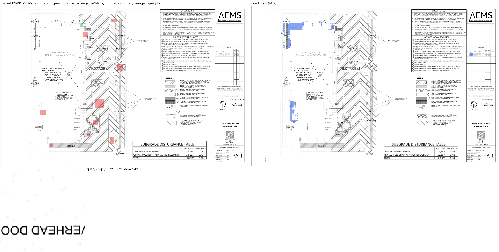

# Hatch Matching

Given a construction drawing and one box drawn around a hatch pattern, this model masks every
other region of the drawing filled with the same pattern. It is my solution to the
[TruTec Hatch Matching Challenge](https://github.com/TruTec-AI/hatch-matching-challenge).

**0.942 document-macro IoU on the public validation split** (57 queries across 13 documents),
with 0.970 recall. The organizer's stated target is 75%+.



Left: the reviewed labels (green is a match, red is not, untinted pixels are not scored) and the
query box in orange. Right: the prediction in blue. Below: the 64x48 px query crop at 4x. This
query scores IoU 1.00.

## Results

Scored by the challenge's own `evaluate.py` on the public validation split. The unedited output
is [`solution/submission/metrics.json`](solution/submission/metrics.json).

| Metric | Value |
|---|---:|
| Document-macro IoU | **0.9420** |
| Mean query IoU | 0.8732 |
| Recall | 0.9700 |
| Precision | 0.7985 |
| Queries / documents | 57 / 13 |

Ten of the 13 documents score 0.96 or higher. The other three sit between 0.74 and 0.79. Two of
them are shown below. The third loses on two 32 px queries, which cover only one or two feature
cells.

**Labels disagree about flat fills.** On this document, a hatched-on-gray query also matches the
flat gray lot on the left (IoU 0.19). In the training labels, a flat fill whose tone matches a
textured query counts as a match about 92% of the time, so the model learned to accept it.
Validation labels this case as a non-match.



**Text inside a sparse pattern.** The query is a sparse dot hatch with "OVERHEAD DOOR" running
through it (IoU 0.26). The model finds the dotted strip, but the mask is fragmented and also
picks up other sparse regions.



## How it works

The pipeline in [`solution/infer.py`](solution/infer.py) scores every 4 px cell of the drawing
for "same pattern as the query", then cleans up the score map.

1. **Patch features.** DINOv2 ViT-S/14 (with registers) runs over overlapping 518 px tiles at
   0.5x and 1x scale. Its last four blocks are fine-tuned on the training split with a
   query-conditioned objective: cells of the same pattern should have a high cosine similarity
   to the query's cells, and other cells a low one.
2. **Similarity features** ([`pixfeat.py`](solution/pixfeat.py)). For each cell: cosine, robust
   and top-k similarity to the query cells, an exemplar-LDA score whitened against the drawing's
   own statistics, and tone, ink, orientation and intensity histograms compared with the query.
3. **Texture features** ([`texfeat.py`](solution/texfeat.py)). A log-polar power spectrum
   captures line spacing by angle. Ink-blob size densities capture dot and dash sizes.
   Normalized cross-correlation compares raw query crops.
4. **Classifier head.** A scikit-learn `HistGradientBoostingClassifier` (162 columns, 400 trees)
   turns those columns into a match probability. Its training rows come from backbones
   fine-tuned on the other cross-validation folds, so it learns on features of the same quality
   it sees at inference.
5. **Clean-up.** The probability grid is blurred (sigma 14 px), enclosed holes are filled
   (labels cover whole regions, including the text inside them), and the result is thresholded
   at 0.5 and upsampled to native resolution.

Inference takes about 22 s per query on an Apple M5 Pro (PyTorch on MPS), with a peak of about
4.4 GB of memory. Details are in the [technical report](solution/report/REPORT.md).

## Experiment log

Every change was selected on 4-fold document-grouped cross-validation over the training split
first, and on public validation second. The full table, with cross-validation and validation
numbers for every run, is in [`solution/EXPERIMENTS.md`](solution/EXPERIMENTS.md).

| Step | Public validation IoU |
|---|---:|
| Zero-shot DINOv2 cosine to the query, threshold tuned on validation | 0.636 |
| Gradient-boosted head on DINOv2 similarities plus tone and ink | 0.842 |
| Add orientation histograms and exemplar-LDA similarity | 0.870 |
| Add query-conditioned texture features (spectrum, blob sizes, NCC) | 0.915 |
| Add blur and hole-fill post-processing | 0.924 |
| Fine-tune the last four DINOv2 blocks | **0.942** |

Texture features were the largest single gain: +0.062 on cross-validation, better on 32 of 62
training documents and worse on 4.

Several ideas measured no gain and were dropped:

- Larger or newer backbones (DINOv2 ViT-B, DINOv3 ViT-S) landed within noise of DINOv2 ViT-S.
- A neural spatial head overfit on its own and lowered the score when stacked on the boosted head.
- Per-query thresholds had real headroom (+0.05 with an oracle), but no label-free predictor
  of the best threshold beat the fixed 0.5.
- Hard-negative mining lost score, and a second-stage region verifier gained nothing. The look-alike
  regions they target are labeled inconsistently across training documents, so no label-free
  feature can separate them.

## Run it

Python 3.12. From the repository root:

```bash
uv venv .venv --python 3.12 && source .venv/bin/activate
uv pip install -r requirements.txt -r solution/requirements.txt
python download_data.py
python make_inputs.py --manifest dataset/val.json --output validation-inputs.json
python solution/infer.py --inputs validation-inputs.json --data-root dataset --output-dir predictions
python evaluate.py --manifest dataset/val.json --data-root dataset --predictions predictions --output metrics.json
```

The first run downloads the pretrained DINOv2 checkpoint (about 88 MB, Hub revision pinned).
The fine-tuned blocks and the head ship in [`solution/weights/`](solution/weights). Pinned
versions and hardware notes are in [`solution/ENVIRONMENT.md`](solution/ENVIRONMENT.md).

Tests:

```bash
python -m unittest discover -s tests            # challenge scorer and utilities
python -m unittest discover -s solution/tests   # feature extraction and inference
```

## Repository layout

| Path | Contents |
|---|---|
| `solution/` | Inference pipeline, feature code, weights, tests |
| `solution/exp/` | Experiment scripts, one folder per line of work |
| `solution/report/REPORT.md` | Technical report, per-document scores, limitations, disclosure |
| `solution/submission/` | Evaluator output, prediction PNGs and checksums |
| `CHALLENGE.md` | The organizer's original README: task, dataset, scoring |
| `SPECIFICATION.md`, `BENCHMARK.md` | The organizer's input, output and metric contracts |

## Credits and data terms

The challenge, dataset, scorer and data tooling are by
[TruTec AI](https://github.com/TruTec-AI/hatch-matching-challenge). Repository code is MIT
([LICENSE](LICENSE)). The drawings in the figures above come from the challenge's public dataset
and are shown with attribution under [DATA_TERMS.md](DATA_TERMS.md), which allows
non-commercial research, evaluation and illustrative examples. The dataset is not
redistributed here (`download_data.py` fetches it from the organizer's release), and it may not
be used commercially or to identify the underlying projects.

The pretrained backbone is [DINOv2](https://github.com/facebookresearch/dinov2) by Meta AI,
loaded through [timm](https://huggingface.co/timm/vit_small_patch14_reg4_dinov2.lvd142m).
